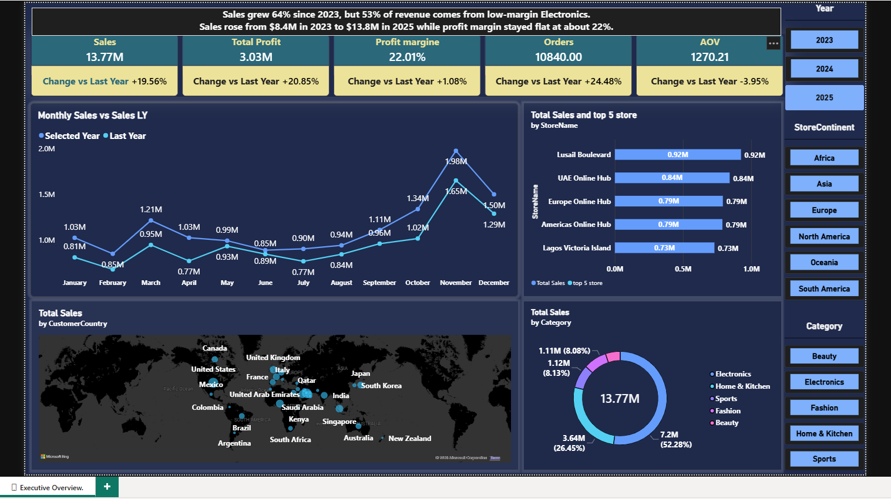
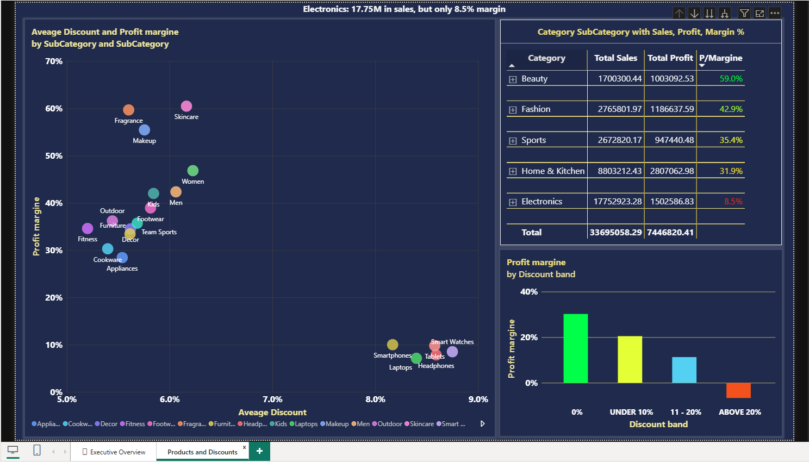

# Global Retail Power BI Dashboard

## DAX Documentation

[View All DAX Measures](./DAX_Measures.md)

---

## Page 1: Executive Overview

[View Screenshot](./screenshots/page1_executive_overview.png)

### Purpose

A one-screen view of sales performance and profit health.

### What it shows

- 5 KPI cards: Sales, Profit, Profit Margin %, Orders and Average Order Value.
- Monthly sales vs last year.
- Sales by customer country.
- Category mix.
- Top 5 stores.
- Year, Continent and Category slicers.

### Key Findings

- Sales grew **64%** from 2023 to 2025 ($8.4M to $13.8M), while profit margin stayed flat at approximately **22%**.
- **Electronics contributes 53% of revenue** but has the lowest category margin.
- The **United States** is the largest customer market, followed by Qatar, Saudi Arabia and the UAE.

---

## Page 2: Products and Discounts

[View Screenshot](./screenshots/page2_products_discounts.png)

### Purpose

Analyze product category performance and understand how discounts affect sales profitability.

### What it shows

- **Category Performance Matrix:** Category and Subcategory breakdown with Sales, Profit and Profit Margin %, using conditional colour formatting.
- **Discount Analysis:** Column chart showing Profit Margin % across different Discount Bands.
- **Discount vs Margin:** Scatter chart comparing discount levels and profit margins by Subcategory.
- **Key Insight Card:** Highlights Electronics' contribution to revenue and its profitability.

### Key Findings

- **Electronics contributes 53% of total sales but has only an 8.5% profit margin.**
- The discount band comparison helps identify how profitability changes across discount levels.
- The scatter chart highlights differences in profit margins between Subcategories at different discount levels.