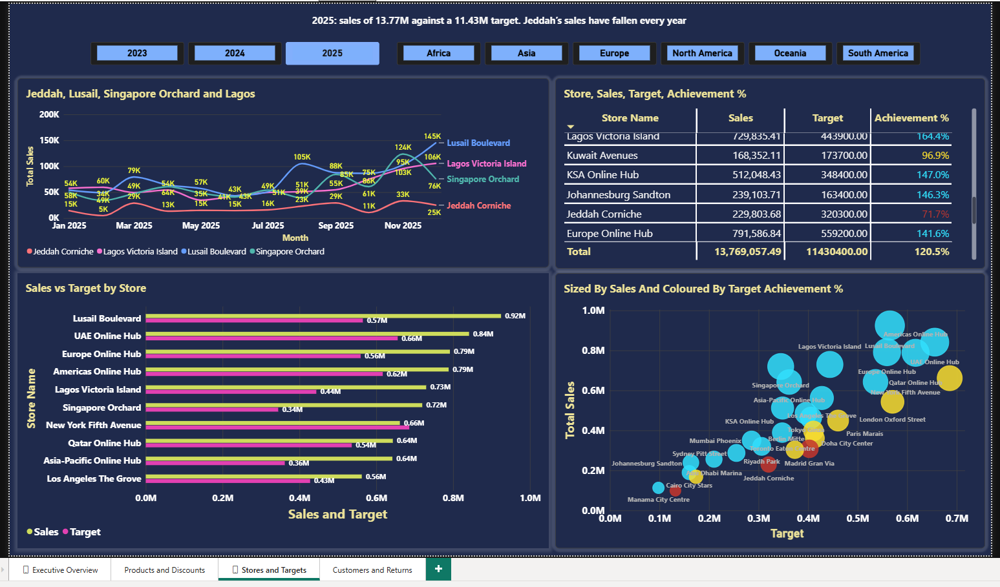
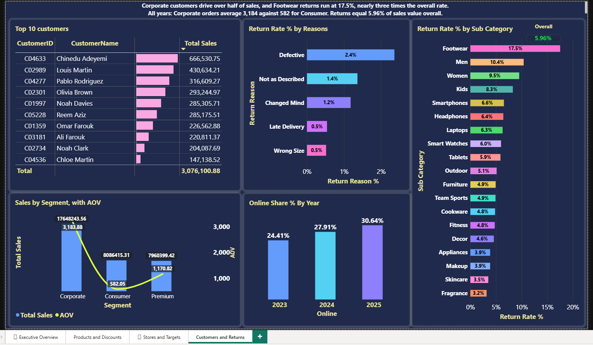

# Global Retail Power BI Dashboard

## DAX Documentation

[View All DAX Measures](./DAX_Measures.md)

---

## Page 1: Executive Overview

[View Screenshot](./screenshots/page1_executive_overview.png)

### Purpose

A one-screen view of sales performance and profit health.

### What it shows

- 5 KPI cards: Sales, Profit, Profit Margin %, Orders and Average Order Value.
- Monthly sales vs last year.
- Sales by customer country.
- Category mix.
- Top 5 stores.
- Year, Continent and Category slicers.

### Key Findings

- Sales grew **64%** from 2023 to 2025 ($8.4M to $13.8M), while profit margin stayed flat at approximately **22%**.
- **Electronics contributes 53% of revenue** but has the lowest category margin.
- The **United States** is the largest customer market, followed by Qatar, Saudi Arabia and the UAE.

---

## Page 2: Products and Discounts

[View Screenshot](./screenshots/page2_products_discounts.png)

### Purpose

Analyze product category performance and understand how discounts affect sales profitability.

### What it shows

- **Category Performance Matrix:** Category and Subcategory breakdown with Sales, Profit and Profit Margin %, using conditional colour formatting.
- **Discount Analysis:** Column chart showing Profit Margin % across different Discount Bands.
- **Discount vs Margin:** Scatter chart comparing discount levels and profit margins by Subcategory.
- **Key Insight Card:** Highlights Electronics' contribution to revenue and its profitability.

### Key Findings

- **Electronics contributes 53% of total sales but has only an 8.5% profit margin.**
- The discount band comparison helps identify how profitability changes across discount levels.
- The scatter chart highlights differences in profit margins between Subcategories at different discount levels.

## Page 3: Stores & Targets

[View Screenshot](./screenshots/page3_stores_targets.png)

**Purpose:** Show which stores are meeting their sales targets and which are falling behind.

**What it shows:** A scatter chart of sales against target for each store, coloured by target achievement, a table of sales, target and achievement, a bar chart of sales against target for every store, and a monthly line chart for Jeddah, Lusail, Singapore Orchard and Lagos.

### Key findings (2025)**

- Stores reached **120.5%** of target overall: **13.77M** in sales against a **11.43M** target.
- **Jeddah** is the clearest problem: it reached only **72%** of target, and its sales fell every year, from **286K** in 2023 to **230K** in 2025. **Muscat (75%)** and **Madrid (77%)** also missed.
- Three new stores far exceeded their targets: **Singapore Orchard (209%)**, **Lusail (164%)** and **Lagos (164%)**.

## Page 4: Customers & Returns

**Purpose:** Show which customers drive revenue and where returns are costing money.

**What it shows:** Sales and average order value by customer segment, the top 10 customers by sales, return rate by subcategory (refund value as a share of sales), and return rate by reason.

**Key findings**

- **Corporate** customers generate **17,648,243.56** in sales, with an average order value of **3,183.88**, more than five times the Consumer segment's **582.05**.
- The **top customer**, Chinedu Adeyemi, generated **666,530.75** in sales, about **1.5 times** the second-largest customer (430,634.21).
- **Footwear** has by far the highest return rate at **17.5%**, against **5.96%** overall. Men's, Women's and Kids' clothing also run above average.
- **Defective** items are the biggest source of returns: they account for **2.4%** of sales value, about 40% of all refunds, ahead of "not as described" (1.4%).